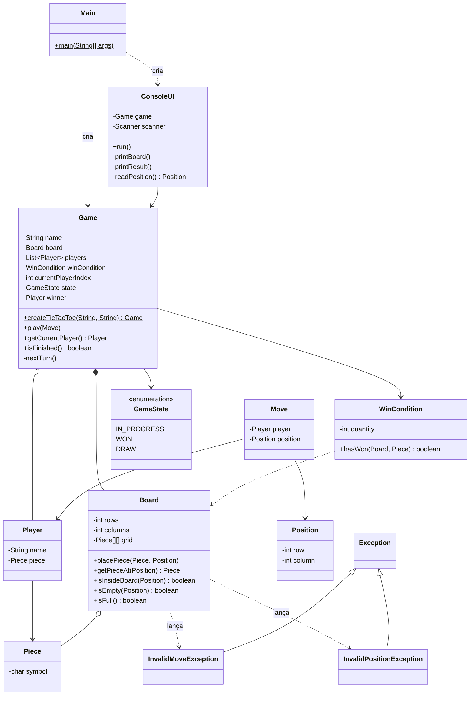

Board Game Engine — Checkpoint 1: Jogo da Velha
Projeto da disciplina Linguagem de Programação Orientada a Objetos (2026.2).
Nesta primeira etapa implementamos um jogo concreto — o Jogo da Velha — em Java,
executado pelo terminal, usando orientação a objetos. Nas próximas etapas vamos
refatorar o código para transformá-lo em uma Engine que carrega jogos por arquivo de configuração.
Integrantes: Arthur de Souza Bezerra e Gabriel de Oliveira Guedes
Como executar
Requisito: Java 11 ou superior (testado com Java 21).
Na pasta raiz do projeto:
```bash
# compilar (Linux/Mac)
mkdir -p out
javac -d out $(find src -name "*.java")

# executar
java -cp out Main
```
No Windows (PowerShell):
```powershell
mkdir out
javac -d out (Get-ChildItem -Recurse src -Filter *.java).FullName
java -cp out Main
```
Também dá para abrir a pasta no IntelliJ/VS Code/Eclipse, marcar `src` como pasta de código-fonte e rodar a classe `Main`.
Como jogar
Digite o nome dos dois jogadores (ou aperte Enter para usar o nome padrão).
Na sua vez, informe a linha e a coluna (de 1 a 3) onde quer colocar sua peça.
Vence quem alinhar 3 peças iguais na horizontal, vertical ou diagonal.
Se o tabuleiro encher sem vencedor, o jogo termina em empate.
Jogadas inválidas (casa ocupada, posição fora do tabuleiro, texto no lugar de número)
mostram uma mensagem e o jogador tenta de novo, sem perder a vez.
Estrutura do projeto
```
src/
├── Main.java                     -> ponto de entrada
├── model/
│   ├── Game.java                 -> controla a partida (turnos, estado, fim de jogo)
│   ├── Board.java                -> tabuleiro
│   ├── Player.java               -> jogador
│   ├── Piece.java                -> peça (X ou O)
│   ├── Position.java             -> linha e coluna
│   ├── Move.java                 -> jogada (jogador + posição)
│   ├── WinCondition.java         -> verifica a vitória por alinhamento
│   └── GameState.java            -> enum: IN_PROGRESS, WON, DRAW
├── exception/
│   ├── InvalidMoveException.java
│   └── InvalidPositionException.java
└── ui/
    └── ConsoleUI.java            -> desenha o tabuleiro e lê as jogadas no terminal
```
Responsabilidade de cada classe
Pergunta	Resposta
Qual classe representa o tabuleiro?	`Board` (matriz `Piece[][]` privada).
Quem valida uma jogada?	`Board.placePiece()` valida a posição e se está vazia; `Game.play()` valida a vez do jogador e se a partida ainda está em andamento.
Onde está o jogador atual?	`Game` (atributo `currentPlayerIndex` + método `getCurrentPlayer()`).
Quem controla os turnos?	`Game.nextTurn()`.
Quem determina que a partida terminou?	`Game.play()`, usando `WinCondition.hasWon()` e `Board.isFull()`; o resultado fica em `GameState`.
Quem verifica a vitória?	`WinCondition`.
Quem mostra o tabuleiro e lê o teclado?	`ConsoleUI` (nenhuma regra do jogo fica nela).
Conceitos de POO usados
Classes e objetos: cada elemento do jogo (tabuleiro, jogador, peça, posição, jogada) é uma classe com uma responsabilidade.
Encapsulamento: atributos `private`; o tabuleiro só é alterado por `placePiece()`, que valida a jogada. `Game` guarda uma cópia da lista de jogadores.
Coleções: `List<Player>` em `Game`.
Tratamento de exceções: `InvalidMoveException` e `InvalidPositionException`, tratadas na `ConsoleUI` (o programa não quebra com stack trace).
Enum: `GameState` para representar o estado da partida.
> Herança, interfaces e polimorfismo ainda não foram necessários com apenas um jogo.
> Eles entram no Checkpoint 2, quando generalizarmos regras como `WinCondition`.
Diagrama de classes

(O GitHub renderiza o diagrama acima automaticamente.)
Exemplo de execução
```
================================
          BOARD ENGINE
================================
Jogo: Jogo da Velha

    1   2   3
  +---+---+---+
1 | X |   | O |
  +---+---+---+
2 |   | X |   |
  +---+---+---+
3 | O |   |   |
  +---+---+---+

Ana (X)
Informe a linha: 3
Informe a coluna: 3
```
