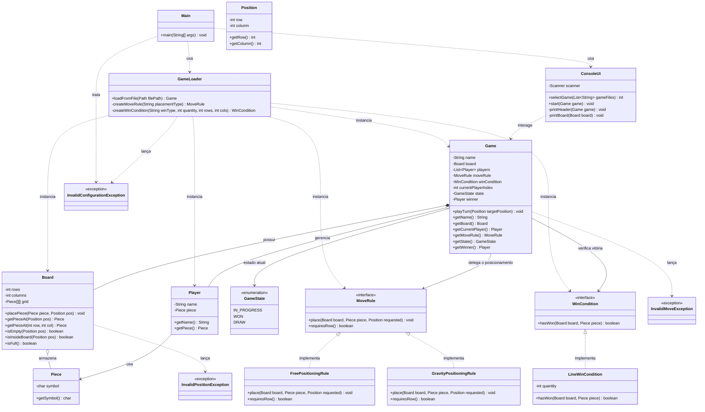

# Board Game Engine

**Alunos:**
* Arthur de Souza Bezerra
* Gabriel de Oliveira Guedes

Motor genérico e extensível para jogos de tabuleiro em terminal desenvolvido em Java, aplicando os conceitos de Programação Orientada a Objetos (POO) para a disciplina de Linguagem de Programação Orientada a Objetos (LPOO).

> *Nota: A estruturação e revisão deste arquivo `README.md` foram elaboradas com o auxílio de Inteligência Artificial.*

---

## Objetivo do Projeto (Checkpoint 2)

Evoluir a implementação inicial para uma **Game Engine** capaz de separar o núcleo de execução das regras específicas de cada jogo. A partir de arquivos de configuração externos no formato `.json`, a aplicação instancia dinamicamente o tabuleiro, os jogadores, as regras de movimentação e as condições de vitória por meio de interfaces e polimorfismo, permitindo executar múltiplos jogos sem alterar o código-fonte da Engine.

### Jogos Suportados Atualmente
* **Jogo da Velha (`games/jogo_da_velha.json`):** Tabuleiro $3 \times 3$, posicionamento livre (`FREE_POSITIONING`) e vitória por alinhamento de 3 peças (`ALIGNMENT`).
* **Connect Four (`games/connect_four.json`):** Tabuleiro $6 \times 7$, posicionamento com efeito de gravidade (`GRAVITY_POSITIONING`) e vitória por alinhamento de 4 peças (`ALIGNMENT`).

---

## Estrutura de Pacotes e Diretórios

```text
board-game-engine-gga-main/
├── games/                                      # Arquivos de configuração dos jogos
│   ├── connect_four.json
│   └── jogo_da_velha.json
└── src/
    ├── Main.java                               # Ponto de entrada: lista os jogos e inicia a Engine
    ├── exception/                              # Exceções personalizadas
    │   ├── InvalidConfigurationException.java  # Erros de validação ou leitura do JSON
    │   ├── InvalidMoveException.java           # Jogadas que violam as regras do jogo
    │   └── InvalidPositionException.java       # Coordenadas fora dos limites do tabuleiro
    ├── loader/                                 # Camada de interpretação de configuração
    │   └── GameLoader.java                     # Lê o JSON e monta os objetos da partida
    ├── model/                                  # Núcleo e regras de domínio da Engine
    │   ├── Board.java
    │   ├── FreePositioningRule.java
    │   ├── Game.java
    │   ├── GameState.java
    │   ├── GravityPositioningRule.java
    │   ├── LineWinCondition.java
    │   ├── MoveRule.java
    │   ├── Piece.java
    │   ├── Player.java
    │   ├── Position.java
    │   └── WinCondition.java
    └── ui/                                     # Interface de interação via console
        └── ConsoleUI.java
```

---

## Como Compilar e Executar

Certifique-se de estar na **raiz do projeto** (no mesmo nível das pastas `src/` e `games/`) e possuir o **JDK 17+** instalado.

### 1. Compilar o código-fonte
```bash
javac -d bin src/*.java src/exception/*.java src/loader/*.java src/model/*.java src/ui/*.java
```

### 2. Executar a Engine
```bash
java -cp bin Main
```

Ao iniciar, a Engine listará automaticamente os arquivos `.json` encontrados na pasta `games/` para que o usuário selecione qual jogo deseja iniciar.

---

## Formato do Arquivo de Configuração (`.json`)

Novos jogos que utilizem regras já suportadas pela Engine podem ser adicionados criando um novo arquivo `.json` dentro da pasta `games/`:

```json
{
  "game": "Nome do Jogo",
  "board": {
    "rows": 3,
    "columns": 3
  },
  "players": {
    "count": 2,
    "symbols": ["X", "O"]
  },
  "rules": {
    "placement": "FREE_POSITIONING",
    "winCondition": {
      "type": "ALIGNMENT",
      "quantity": 3
    }
  }
}
```

* **`placement` (Regra de Posicionamento):** `FREE_POSITIONING` ou `GRAVITY_POSITIONING`.
* **`winCondition.type` (Condição de Vitória):** `ALIGNMENT` (com `quantity` indicando a sequência necessária para vencer).
* Configurações inválidas (dimensões $\le 0$, regras inexistentes ou arquivos mal formatados) são interceptadas pela `InvalidConfigurationException`, exibindo uma mensagem amigável no terminal.

---

## Diagrama de Classes (UML)


